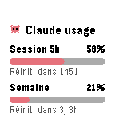
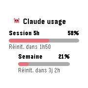
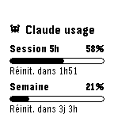
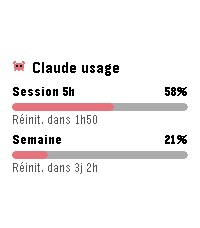

# AI Usage

Application Pebble qui affiche les jauges d'utilisation de Claude.ai
(session de 5 h, limite hebdomadaire, et dépassement lorsqu'il est actif)
directement sur la montre, avec le temps restant avant réinitialisation sous
chaque jauge.

|               Pebble Time                |               Time Round               |                  Pebble 2                  |                 Time 2                 |
| :--------------------------------------: | :------------------------------------: | :----------------------------------------: | :------------------------------------: |
|  |  |  |  |

## Fonctionnement

- Le téléphone (PebbleKit JS) envoie une requête sonde minimale
  (`max_tokens: 1`, ~1 token) sur `/v1/messages` avec un token OAuth
  Claude Code, et lit les en-têtes `anthropic-ratelimit-unified-*-utilization`
  (fraction 0-1) et `-reset` (epoch Unix) — même méthode que
  [Clawdmeter](https://github.com/HermannBjorgvin/Clawdmeter) et
  [claude-usage-stick](https://github.com/oauramos/claude-usage-stick).
  Ces en-têtes sont accessibles avec le scope `user:inference` des tokens
  `claude setup-token` (contrairement à l'endpoint `/api/oauth/usage`, qui
  exige `user:profile`).
- Une ligne « Utilisation des crédits en cours » s'ajoute sous les deux jauges
  quand l'en-tête `anthropic-ratelimit-unified-overage-in-use` vaut `true`,
  c'est-à-dire quand les crédits prennent le relais d'un forfait épuisé.
  C'est un indicateur et non une jauge : les en-têtes ne donnent aucun
  pourcentage pour ce bucket (voir plus bas), et aucune échéance n'est
  affichée puisque `overage-reset` ne porte que sur la facturation mensuelle.
- Sur la montre : en-tête « Claude usage » avec Clawd (la mascotte de
  Claude Code) en pixel art, puis une jauge par ligne — intitulé et
  pourcentage au-dessus de la barre, compte à rebours de réinitialisation
  en dessous. Couleurs claude.ai (barre corail `#D97757`). Sur les écrans
  ronds, la largeur de chaque jauge s'adapte à la corde du cercle à sa
  hauteur.
- Les dernières valeurs sont persistées sur la montre et affichées
  immédiatement à l'ouverture, le temps du rafraîchissement.
- Interface disponible en anglais et en français : les textes de la montre
  suivent la langue de la montre (`i18n_get_system_locale`), les messages
  de statut et la page de réglages suivent celle du téléphone
  (`navigator.language`).

### Ce que les en-têtes ne donnent pas : le solde de crédits

Les en-têtes disent **si** l'on est en dépassement, jamais **combien** on a
dépensé. Relevé sur un compte réel en dépassement actif (15/08/2026 18:41),
avec 5,10 € de crédits consommés sur un plafond mensuel de 10,00 € :

| Source                                         | Valeur             |
| ---------------------------------------------- | ------------------ |
| en-tête `overage-in-use`                       | `true`             |
| en-tête `overage-utilization`                  | `0.0`              |
| en-tête `5h-utilization` / `5h-status`         | `1.0` / `rejected` |
| `/api/oauth/usage` → `extra_usage.utilization` | `51.0`             |
| `/api/oauth/usage` → `spend.percent`           | `51`               |

Piège à éviter : `overage-utilization` ne suit pas la consommation de
crédits. Il vaut `0.0` au moment même où l'on puise dessus, si bien qu'une
jauge conditionnée à « utilisation > 0 » ne s'affiche jamais. Seul
`overage-in-use` distingue les deux états. De même, `overage-reset` ne
délimite pas une fenêtre courte : il pointait le 01/09/2026, soit la
réinitialisation mensuelle des crédits 16 jours plus tard.

Le montant en euros n'existe que sur `/api/oauth/usage` (champs
`extra_usage` et `spend`), qui exige le scope `user:profile`. Les tokens
`claude setup-token` sont annoncés comme limités à `user:inference`
(« Long-lived tokens […] are limited to inference-only for security
reasons », message de la CLI Claude Code) — annonce non vérifiée par une
mesure ici, contrairement au reste de ce tableau. Le token de session de
Claude Code, lui, porte bien `user:profile`, mais s'en servir imposerait
d'en gérer le rafraîchissement, avec un risque de rotation du refresh token
invalidant la session Claude Code de l'utilisateur.

## Configuration

1. Sur un ordinateur avec Claude Code : `claude setup-token`, copier le token.
2. Dans l'app Pebble du téléphone : ouvrir les réglages de « AI Usage »
   (page générée localement par Clay), coller le token et choisir la
   période de mise à jour, puis Enregistrer. Le token reste sur le
   téléphone, il n'est jamais envoyé à la montre.

Les mises à jour n'ont lieu que lorsque l'application est ouverte sur la
montre : PebbleKit JS ne tourne pas en arrière-plan.

## Boutons

- **Haut / Bas** : défilement si toutes les jauges ne tiennent pas à l'écran.
- **Select** : rafraîchir immédiatement (sinon rafraîchissement automatique
  selon la période configurée, 5 min par défaut).

## Développement

```sh
pebble build                          # build pour toutes les plateformes
pebble install --emulator chalk       # tester sur l'émulateur rond
pebble install --phone <ip>           # installer sur le téléphone
```

Plateformes ciblées : aplite, basalt, chalk, diorite, emery, flint, gabbro.
La page de configuration utilise [@rebble/clay](https://www.npmjs.com/package/@rebble/clay)
(le fork Rebble de pebble-clay, compatible flint/gabbro).

## Structure

```
src/c/main.c         Cycle de vie, fenêtre, boutons, timer minute
src/c/gauges.c/.h    Modèle de données : jauges, statut, persistance
src/c/ui.c/.h        Rendu : titre, jauges adaptatives, défilement, resets
src/c/mascot.c/.h    Clawd en pixel art
src/c/comm.c/.h      AppMessage montre <-> téléphone
src/c/theme.h        Couleurs claude.ai (et équivalents noir & blanc)
src/pkjs/index.js    Côté téléphone : sonde API + en-têtes ratelimit, Clay
src/pkjs/config.js   Page de configuration (token, période de mise à jour)
```

## Licence

[MIT](LICENSE)
